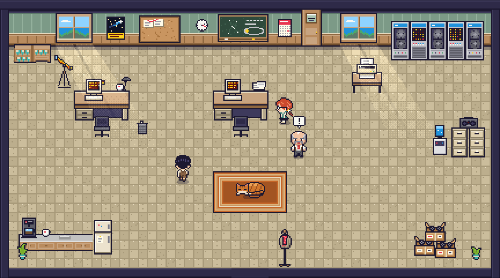
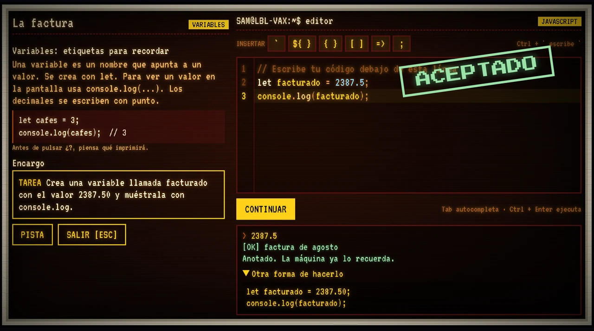

# 75 Centavos

**A pixel-art detective game that teaches JavaScript from scratch.** Berkeley, 1986: the
lab's accounting is off by 75 cents, and pulling that thread uncovers an intruder who
breaks in at night from across the ocean. You solve the case by writing real JavaScript
in a CRT terminal; each mission introduces a language feature right when the story needs it.

**Play it:** https://75-centavos.vercel.app (free, in Spanish, no account required)




- 6 acts, 30 missions: variables and conditionals up to closures, classes, promises and `async/await`.
- Player code runs in a sandboxed Web Worker with a time limit and is checked against several test cases.
- Hand-drawn pixel art, sound generated in code, a notebook to review every concept.

**Tech stack:** TypeScript, Vite, Phaser 4, CodeMirror 6, Web Workers, ZzFX, Vitest.
Optional cloud saves and profiles use Clerk (accounts) and Neon Postgres through Vercel
serverless functions (`api/`).

### Run locally

```bash
npm install
npm run dev     # http://localhost:5173
npm test        # Vitest
npm run build   # type-check + production build
```

The game works without any environment variables (progress is saved in the browser).
To enable accounts and cloud saves, copy `.env.example` to `.env.local` and set:

- `NEXT_PUBLIC_CLERK_PUBLISHABLE_KEY` (Clerk, exposed to the browser)
- `CLERK_SECRET_KEY` (Clerk, server only)
- `DATABASE_URL` (Neon Postgres, server only; create tables with `node --env-file=.env.local scripts/db-init.mjs`)

The `api/` functions run on Vercel; use `vercel dev` to run them locally.

### License

Code: [MIT](LICENSE). Third-party art keeps its own licenses: Kenney's Roguelike Indoors
(CC0, [`public/assets/vendor/LICENSE-kenney.txt`](public/assets/vendor/LICENSE-kenney.txt)),
piano_no_renshu characters (CC0, [`tools/art/source/LICENSE-piano.txt`](tools/art/source/LICENSE-piano.txt))
and the Pixelify Sans, Press Start 2P and VT323 fonts (SIL OFL, Google Fonts).

---

## Español

Juego pixel art para aprender JavaScript desde cero. Berkeley, 1986: la contabilidad
del laboratorio no cuadra por 75 centavos y, tirando del hilo, aparece un intruso que
entra de noche desde el otro lado del océano. Inspirado en hechos reales; personajes y
nombres ficticios.

El jugador escribe **JavaScript real** en una terminal CRT y cada misión enseña una
palabra del lenguaje justo cuando la historia la necesita.

## Estado: historia principal completa, 6 actos y 30 misiones

| Acto | Misiones | Conceptos |
|---|---|---|
| 1 · El descuadre (agosto 1986) | La factura, El descuadre, Una cuenta sin dueño, Turno de madrugada, Noches en vela | `let`, operaciones, plantillas, `if/else`, `for` |
| 2 · La trampa (septiembre 1986) | Tres nombres, Solo de madrugada, La alarma de bolsillo, Minutos en línea, El anzuelo | arrays, recorrer y `push`, funciones, parámetros y `return` |
| 3 · El rastro (diciembre 1986) | Ficha de conexión, El expediente, Filtrar el ruido, Lo que busca, Hora y media | objetos, arrays de objetos, `filter`, `map`, `for...of` y acumuladores |
| 4 · El comprador (enero 1987) | Lo que ve cada bloque, Un contador que recuerda, Palabras clave, Hablan de dinero, La bóveda | alcance, closures, fábricas de funciones, estado privado |
| 5 · La conexión (marzo 1987) | Planos de un nodo, Que cada nodo se presente, La ruta completa, Ficha del sospechoso, Mantenerlo en línea | clases, métodos, `this`, herencia con `extends` y `super` |
| 6 · Tiempo real (junio 1987) | Más tarde, Una promesa de Bremen, Uno tras otro, El nodo que no contesta, Todos a la vez | `setTimeout`, promesas, `async/await`, `try/catch`, `Promise.all` |

Cada acto termina con el rastreo de la llamada en un mapa de red de 1986.

**Cuaderno de Sam** (tecla C): mapa de ruta de lo aprendido, ficha de cada concepto,
pregunta de "¿qué imprime?" y práctica en la terminal sin tocar el progreso.

**Menú de pausa** (Esc): radio con dos emisoras, volúmenes, pantalla completa, filtro CRT y controles.

Cada acto ocurre en otro mes y el laboratorio lo muestra: luces de Navidad, nieve, lluvia con relámpagos.

## Desarrollo

```bash
npm install
npm run dev        # http://localhost:5173
npm test           # misiones y preguntas del cuaderno (vitest)
npm run build      # tipos + build de producción
python3 tools/art/build_art.py   # regenera el arte propio en public/assets
python3 tools/art/characters.py  # regenera los personajes
```

## Cómo está hecho

- **Vite + TypeScript + Phaser 4** para el mundo; la interfaz (diálogos, terminal,
  corcho) es DOM encima del canvas.
- **CodeMirror 6** como editor, con autocompletado (Tab) de lo que el jugador ya aprendió.
- El código del jugador corre en un **Web Worker** con límite de 1,5 s (un bucle
  infinito no congela el juego) y en modo estricto. Las misiones asíncronas usan una
  variante que permite `await` y espera los temporizadores pendientes. Cada misión lo prueba contra varios
  casos, para que escribir el resultado a mano no sirva. Ver `src/game/missions.ts`.
- Resolución interna 480x270 escalada por enteros: píxeles nítidos.
- Luz nocturna calculada por píxel con tramado Bayer (`src/scenes/lighting.ts`).
- Sonido generado por código con ZzFX; la radio del laboratorio sintetiza su música con Web Audio.

## Arte y licencias

- Arte propio (suelo, paredes, terminales, minicomputadora, impresora, corcho, pizarra,
  gata, telescopio, mapa…): `tools/art/build_art.py`, dibujado píxel a píxel con una
  paleta común.
- Personajes propios (Sam, Ruth, Kessler): `tools/art/characters.py`.
- Algunos muebles: **Roguelike Indoors** de Kenney (CC0).
- Fuentes: Pixelify Sans, Press Start 2P y VT323 (OFL, Google Fonts).

- Personajes base: **piano_no_renshu** (CC0).

El código está bajo licencia [MIT](LICENSE). El arte de terceros conserva sus propias
licencias CC0: `public/assets/vendor/LICENSE-kenney.txt` y `tools/art/source/LICENSE-piano.txt`.
